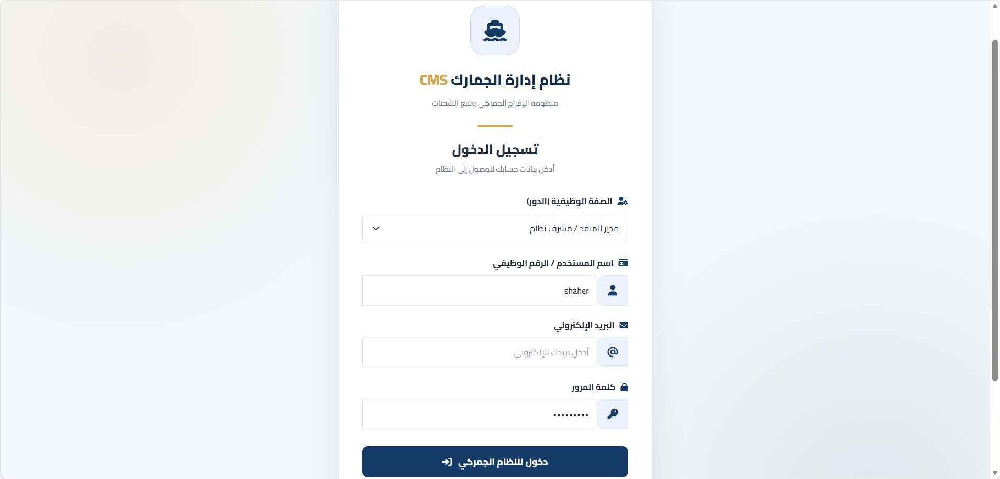
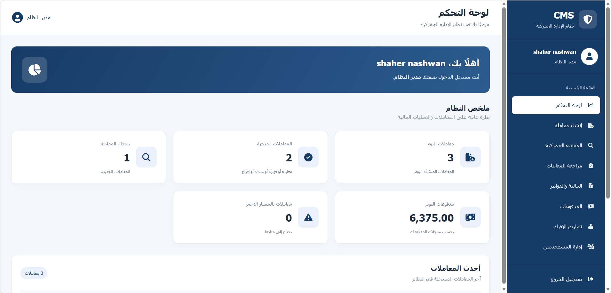
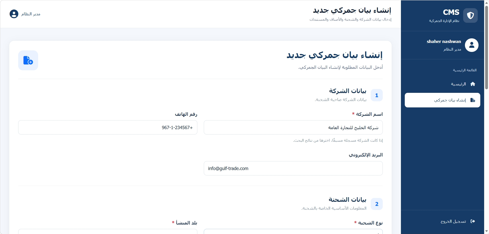
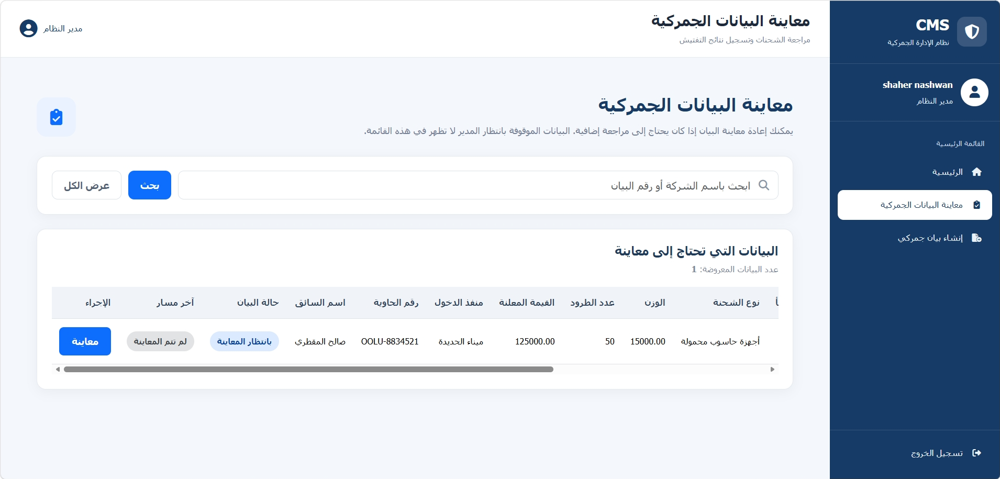
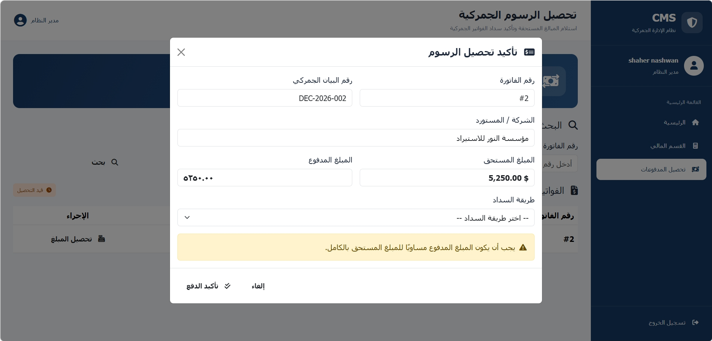
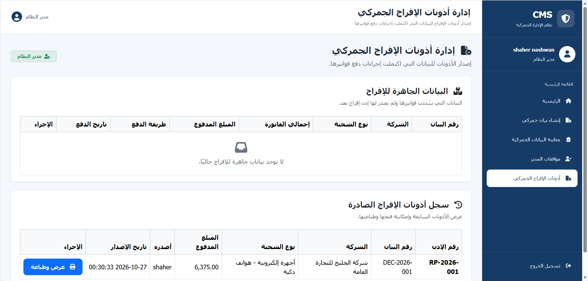

  

<h1 align="center">نظام إدارة الجمارك | Customs Management System</h1>

  نظام ويب لإدارة البيانات الجمركية والمعاينة والفواتير والمدفوعات وتصاريح الإفراج والمستخدمين.

  
  
  
  

Table of Contents

- [Overview](#overview)
- [Demo](#demo)
- [Screenshots](#screenshots)
- [Features](#features)
- [Tech Stack](#tech-stack)
- [Architecture](#architecture)
- [Requirements](#requirements)
- [Installation](#installation)
- [Environment Configuration](#environment-configuration)
- [Security](#security)
- [Project Structure](#project-structure)
- [Development Guidelines](#development-guidelines)
- [Troubleshooting](#troubleshooting)
- [Roadmap](#roadmap)
- [Contributing](#contributing)
- [License](#license)
---

Overview

Customs Management System هو تطبيق ويب لإدارة الإجراءات الجمركية من تسجيل البيان وحتى إصدار تصريح الإفراج.

يدعم النظام صلاحيات متعددة وواجهات عربية باتجاه RTL، ويستخدم PHP وPDO لمعالجة البيانات.

Live Demo: قيد النشر.

---

Demo

Demo accounts to be created upon deployment

«TODO: create demo users before going live»

لا توجد حسابات تجريبية جاهزة في قاعدة البيانات حاليًا.

---

## 📸 Screenshots

### تسجيل الدخول

### لوحة التحكم

### إنشاء بيان جمركي

### المعاينة الجمركية

### المدفوعات

### تصريح الإفراج

Features

User Roles

- Manager: إدارة النظام ومتابعة العمليات.
- Broker: تسجيل البيانات الجمركية ومتابعتها.
- Inspector: معاينة البيانات وتسجيل نتائج الفحص.
- Accountant: إدارة الفواتير والمدفوعات.

Core Modules

- Declarations: إنشاء البيانات الجمركية وإرفاق الملفات.
- Routing: تصنيف المسار إلى أخضر أو أصفر أو أحمر.
- Inspection: تسجيل نتائج المعاينة والمراجعة والموافقة.
- Finance: إدارة الفواتير والمدفوعات.
- Release Permits: إصدار تصاريح الإفراج وطباعتها.
- User Management: إدارة الحسابات والصلاحيات.

---

Tech Stack

Technology| Usage
PHP 8.0+| Backend
MySQL / MariaDB| Database
PDO| Database access
JavaScript| Frontend interactions
Fetch API / AJAX| Asynchronous requests
Vanilla CSS| Styling and RTL layout
Font Awesome| Icons
XAMPP| Local development environment

لا يتطلب المشروع Composer أو npm أو Node.js أو أطر عمل للواجهة الأمامية.

---

Architecture

يفصل المشروع بين معالجة الطلبات ومنطق الأعمال والوصول إلى البيانات وعرض الواجهات.

Browser
   |
   v
Backend_controller/
   |
   v
app/Controllers/ --> app/Services/
   |                    |
   v                    v
app/Models/ --------> Database
   |
   v
app/Helpers/ + resources/views/

- Backend_controller/: معالجة طلبات HTTP والتحقق من الجلسات والصلاحيات وCSRF.
- app/Controllers/: تنسيق تدفق العمليات.
- app/Services/: منطق الأعمال.
- app/Models/: الوصول إلى البيانات.
- app/Helpers/: دوال التحقق والتنسيق والمساعدة.
- resources/views/: واجهات المستخدم والقوالب والأجزاء المشتركة.

للتفاصيل المعمارية الإضافية، راجع ARCHITECTURE.md إذا كان موجودًا في المستودع.

---

Requirements

- PHP 8.0 أو أحدث.
- MySQL أو MariaDB.
- XAMPP أو بيئة PHP مماثلة.
- تفعيل امتداد PDO المناسب لقاعدة البيانات.

---

Installation

Step 1 — Clone the Repository

git clone <YOUR_REPOSITORY_URL>

ضع المشروع داخل مجلد خادم الويب، مثل:

C:\xampp\htdocs\CMS

Step 2 — Start Services

من لوحة تحكم XAMPP، شغّل Apache وMySQL.

Step 3 — Create Database

أنشئ قاعدة البيانات التالية:

CREATE DATABASE cms_db
CHARACTER SET utf8mb4
COLLATE utf8mb4_unicode_ci;

استورد مخطط قاعدة البيانات والبيانات الأولية إذا كانت ملفات الاستيراد متوفرة في المشروع.

Step 4 — Configure Environment

أنشئ ملف .env في جذر المشروع، ثم أضف الإعدادات التالية:

APP_ENV=local
APP_DEBUG=true
APP_NAME="نظام الجمارك"
APP_TIMEZONE=Asia/Aden

DB_HOST=localhost
DB_PORT=3307
DB_NAME=cms_db
DB_USER=root
DB_PASS=
DB_CHARSET=utf8mb4

تأكد من أن منفذ قاعدة البيانات وبيانات الاتصال تطابق إعدادات بيئتك المحلية.

Step 5 — Open the Application

http://localhost/CMS/

عدّل العنوان إذا كان مسار المشروع مختلفًا.

---

Environment Configuration

يُحمّل المشروع إعدادات البيئة باستخدام config/env_loader.php.

- احتفظ بملف .env خارج مستودع Git.
- لا ترفع كلمات المرور أو بيانات الاتصال الحساسة.
- استخدم إعدادات الإنتاج المناسبة عند النشر.
- اجعل APP_DEBUG=false في بيئة الإنتاج.
- تأكد من أن أسماء متغيرات البيئة تطابق ما يقرأه التطبيق.

---

Security

Practice| Purpose
PDO Prepared Statements| تقليل مخاطر SQL Injection
CSRF Tokens| حماية الطلبات من CSRF
password_hash() / password_verify()| تخزين كلمات المرور والتحقق منها
Session Security| حماية الجلسات والتحقق من الصلاحيات
e() Output Escaping| تقليل مخاطر XSS عند إخراج البيانات
File Upload Validation| التحقق من نوع الملفات وامتدادها وحجمها

يجب اختبار الضوابط الأمنية في جميع المسارات الحساسة قبل اعتبار النظام جاهزًا للإنتاج.

---

Project Structure

CMS/
├── app/
│   ├── Controllers/
│   ├── Helpers/
│   │   └── dashboard_view_helpers.php
│   ├── Models/
│   └── Services/
├── Backend_controller/
├── config/
│   ├── config.php
│   └── env_loader.php
├── database/
│   └── seeds/
├── assets/
│   ├── css/
│   ├── js/
│   └── images/
├── includes/
│   └── dashboard_sidebar.php
├── resources/
│   └── views/
│       └── dashboard/
│           └── partials/
├── storage/
│   └── logs/
├── tests/
├── docs/
│   └── screenshots/
├── dashboard.php
├── login.php
├── logout.php
├── declaration_new.php
├── inspection.php
├── finance.php
├── payment.php
├── release_permits.php
├── print_release_permit.php
├── auth_users.php
├── composer.json
├── .env.example
├── .gitignore
├── LICENSE
├── ARCHITECTURE.md
└── README.md

Development Guidelines

- اتبع نمط تقسيم الملفات المعتمد في المشروع.
- استخدم PDO Prepared Statements للاستعلامات.
- تحقّق من الجلسة والصلاحيات في المسارات الحساسة.
- تحقّق من صحة البيانات على الخادم قبل معالجتها.
- لا تضع الأسرار أو بيانات الاتصال في المستودع.
- اختبر التغييرات قبل دمجها.

---

Troubleshooting

- Database connection failed: راجع DB_HOST وDB_PORT وبيانات الاتصال.
- Unknown database: تأكد من إنشاء cms_db.
- Access denied: تحقق من اسم المستخدم وكلمة المرور.
- Page not found: راجع مسار المشروع داخل مجلد خادم الويب.
- Uploads failing: راجع صلاحيات المجلد وحدود PHP لحجم الملفات.
- Debugging errors: افحص سجلات PHP وسجلات التطبيق عند توفرها.

---

Roadmap

- تحسين تغطية الاختبارات الآلية.
- مراجعة ضوابط الأمان قبل النشر.
- إضافة بيانات تجريبية آمنة لبيئة العرض.
- توثيق مخطط قاعدة البيانات وإجراءات التثبيت.
- إعداد نسخة تجريبية منشورة عند اكتمال التجهيزات.

---

Contributing

1. أنشئ Fork للمستودع.
2. أنشئ فرعًا جديدًا للتغيير.
3. اختبر التعديلات وتأكد من عدم كشف بيانات حساسة.
4. أرسل Pull Request مع وصف واضح للتغيير.

## 📄 License

هذا المشروع مرخّص تحت **MIT License**.

اقرأ ملف [LICENSE](LICENSE) للتفاصيل الكاملة.